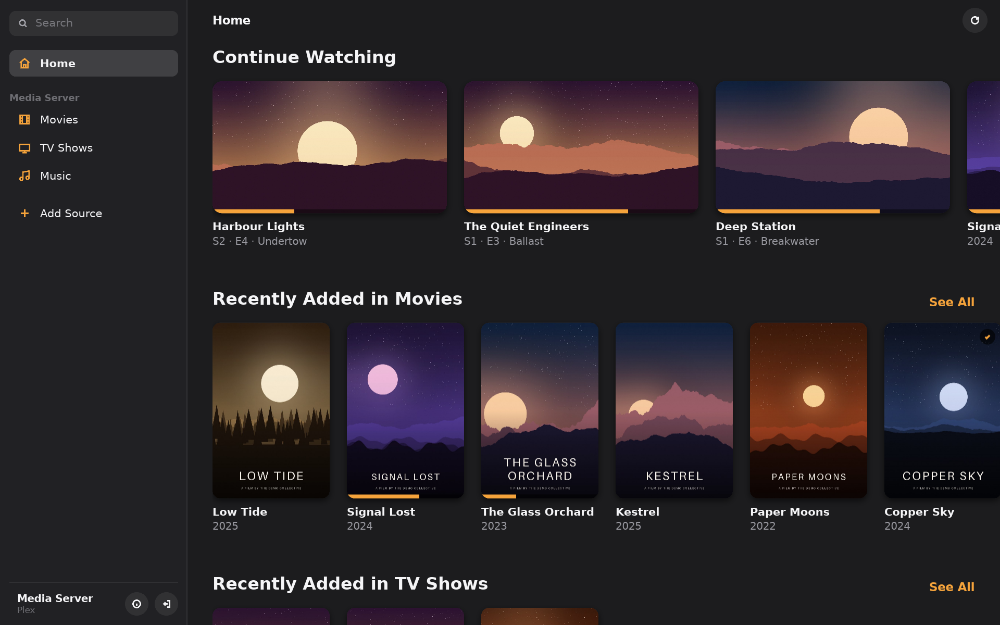
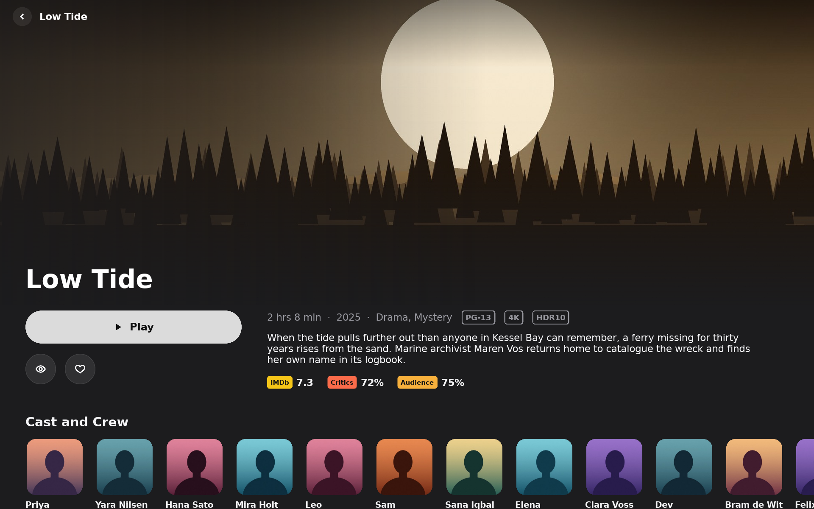
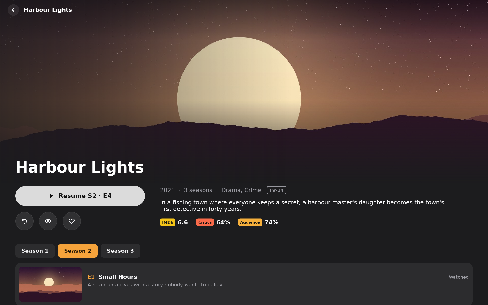
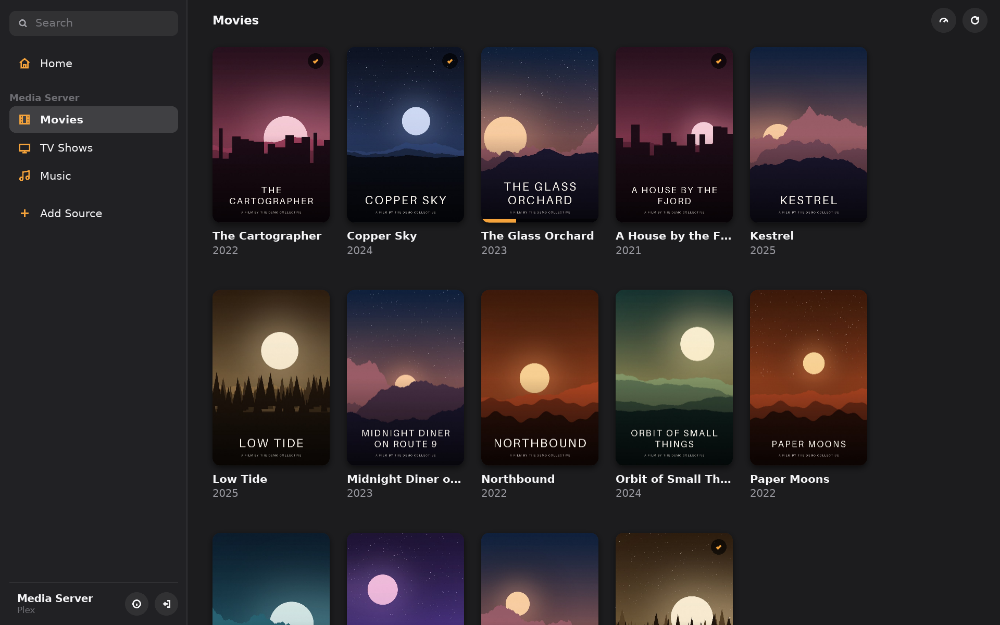
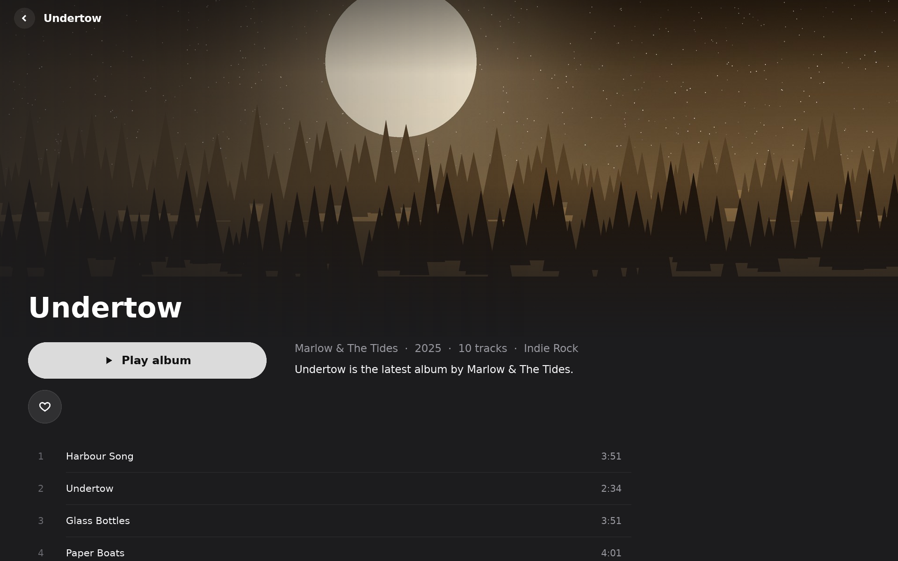

# Encheo

An open-source media player for **Windows, Linux, macOS and Android** (phones, tablets and TV).

Encheo keeps no media of its own: it pours in what you already have (*enchéō*, Greek for
"to pour in"). Connect a media server and it becomes a library with artwork, details and
progress that follows you between devices. Playback is direct, so nearly every format plays
as it is, including 4K HDR and lossless audio.

> **Status:** early, but usable. Plex is the first supported source; local files, network
> shares, Jellyfin, Emby and cloud drives are planned. See the [feature map](docs/parity.md) and
> the [architecture](docs/architecture.md).



## Features

- **Library:** home screen with Continue Watching and recently added titles, libraries for
  movies, TV and music, search
- **Details:** artwork, ratings, cast and crew, related titles, file and format information
- **Playback:** hardware decoding, chapters, episode list, next episode, skip intro and credits,
  speed control, Picture in Picture and fullscreen on desktop, progress synced to your server
- **Audio and subtitles:** your choices remembered per show; untagged subtitle tracks get their
  language detected from the text
- **Music:** artists, albums and a play queue
- **Every screen:** mouse, touch, keyboard and TV remote

<table>
  <tr>
    <td></td>
    <td></td>
  </tr>
  <tr>
    <td></td>
    <td></td>
  </tr>
</table>

The screenshots show a made-up library on a pretend Plex server. GitHub Actions takes them on every
build ([scripts/screenshots](scripts/screenshots)); to take them yourself, build Encheo and run
`scripts/screenshots/run.sh` (needs Python with Pillow).

## Building

Encheo is written in Rust. The UI uses [Slint](https://slint.dev) and playback uses
[libmpv](https://mpv.io), so you need a stable Rust toolchain and libmpv.

**macOS**

```sh
brew install mpv
scripts/dev-app.sh
```

**Linux** (Debian/Ubuntu package names)

```sh
sudo apt install libmpv-dev pkg-config libfontconfig1-dev libxkbcommon-dev libxkbcommon-x11-dev
cargo run -p encheo
```

**Windows**

Get `mpv-dev-x86_64-*.7z` from
[shinchiro/mpv-winbuild-cmake](https://github.com/shinchiro/mpv-winbuild-cmake/releases), create
an import library (see `.github/workflows/build.yml`), set `MPV_LIB_DIR` to that folder and put
`libmpv-2.dll` next to `encheo.exe`.

**Android**

```sh
cargo install cargo-apk
rustup target add aarch64-linux-android
scripts/android.sh run
```

Needs the Android SDK and NDK (`ANDROID_HOME`, `ANDROID_NDK_ROOT`).

Every push is built for all four platforms in GitHub Actions; the builds are attached to each run.

## Project layout

```
crates/plex      media server client (Plex)
crates/sublang   subtitle language detection
apps/encheo      the app: UI, player and glue
```

## Licence

[Mozilla Public License 2.0](LICENSE). Versions up to 0.1.0 were released under GPL-3.0-or-later.

Built with [Slint](https://slint.dev) (under the Slint Royalty-free License) and
[libmpv](https://mpv.io). [](https://slint.dev)
