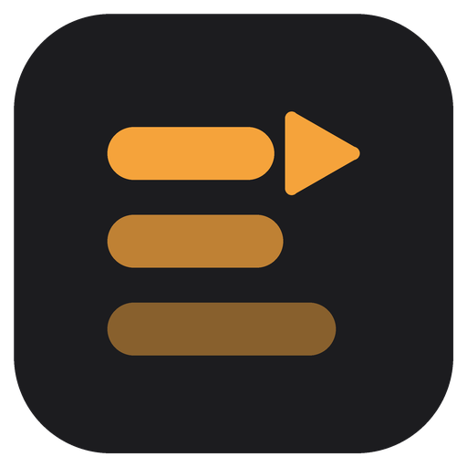
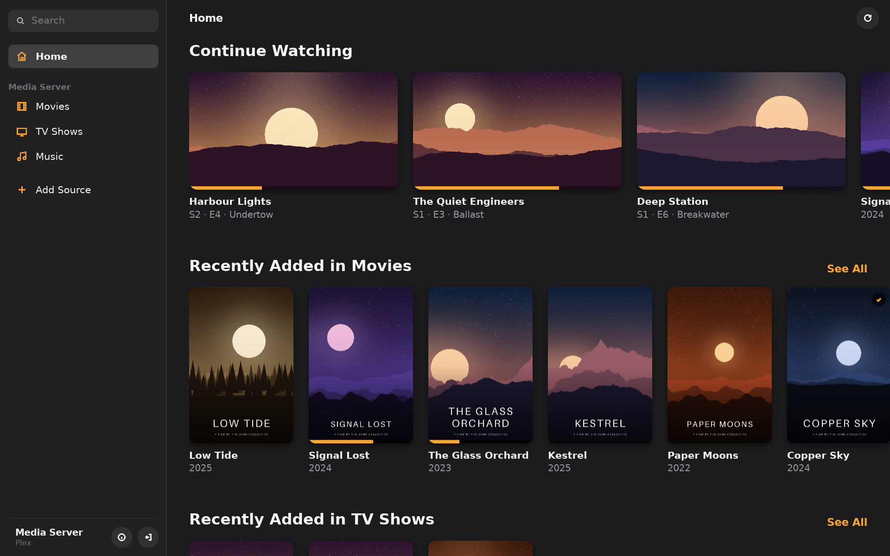
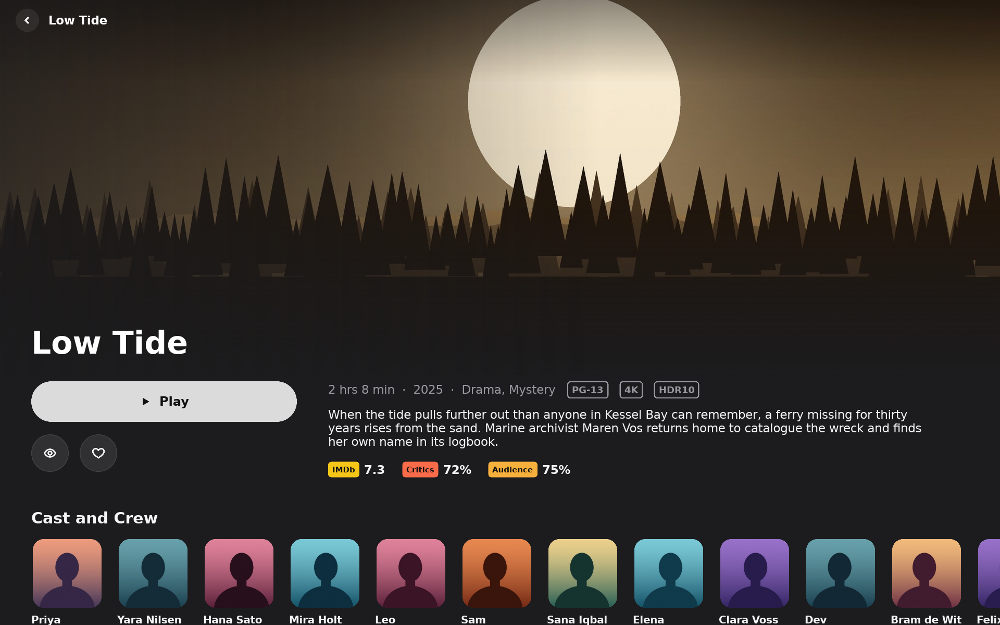
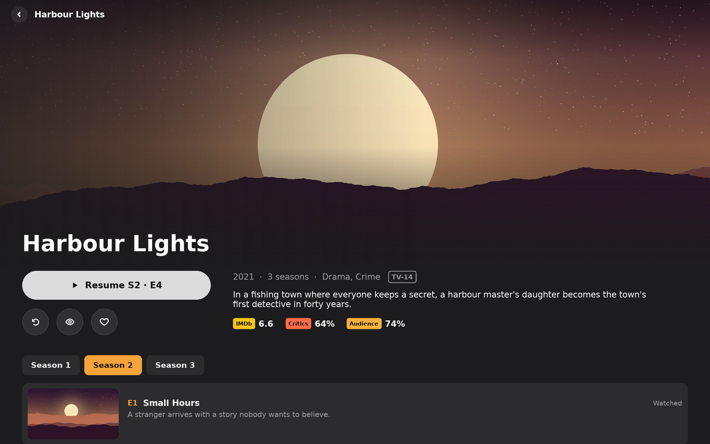
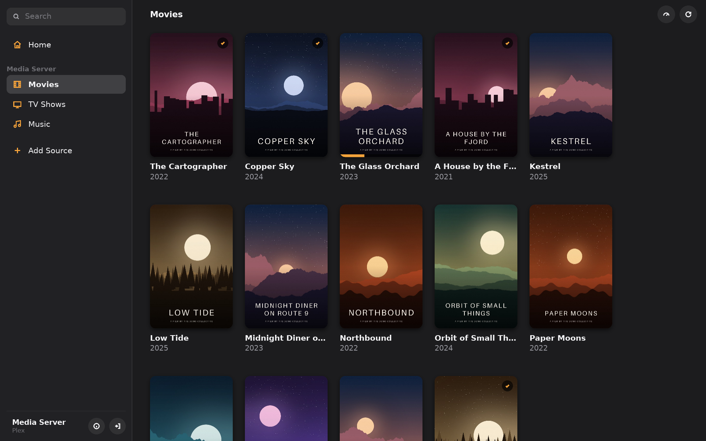
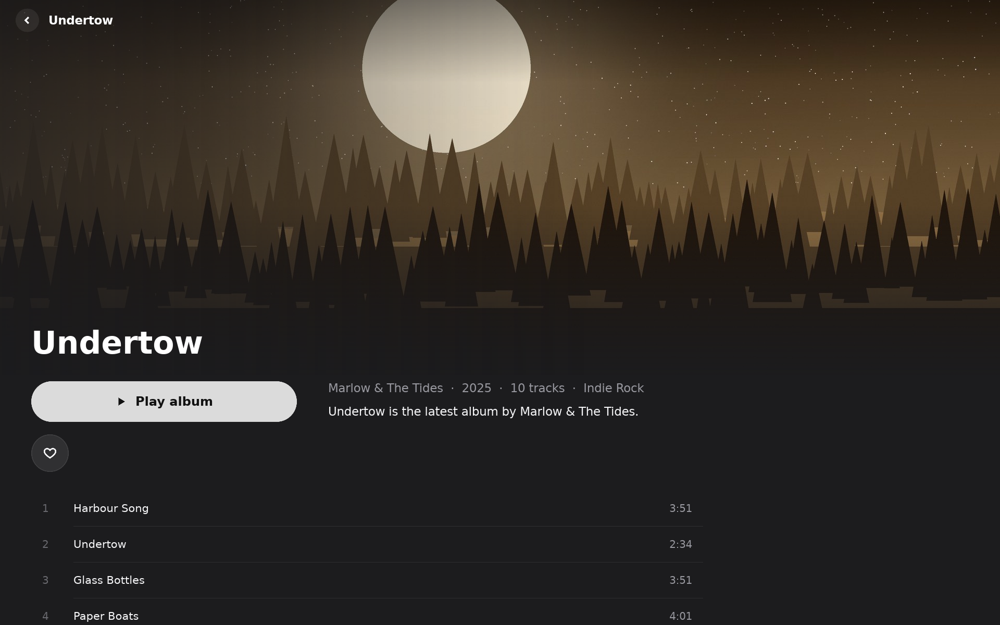

<div align="center">



# Encheo

**One player for everything you already have: Plex, Jellyfin, Emby and the files on your network.**

[](https://github.com/KumaVolt/encheo/releases)
[](https://github.com/KumaVolt/encheo/actions/workflows/build.yml)

[](LICENSE)
[](https://slint.dev)

[Download](#download) · [Features](#features) · [How it works](#how-it-works) · [FAQ](#faq) · [Development](#development)



<sub>The screenshots show a made-up library on a pretend Plex server.</sub>

</div>

## Why Encheo

Encheo keeps no media of its own: it pours in what you already have (*enchéō*, Greek for "to pour
in"). Point it at a media server or a network share and it becomes one library with artwork,
details and progress that follows you between devices.

- **Direct play.** Files play as they are through [libmpv](https://mpv.io), so 4K HDR, lossless
  audio and odd containers work without the server transcoding anything.
- **One app on every screen.** The same app runs on desktops, phones, tablets and Google TV, with
  mouse, touch, keyboard or a TV remote.
- **Nothing extra to run.** No server of its own, no Encheo account, no analytics.

> [!NOTE]
> Encheo is early: every release so far is a pre-release. macOS and Android are tested on real
> devices, Windows and Linux build in CI but get little testing, and iOS is experimental. The
> [feature map](docs/parity.md) shows what's built and what's next.

### Sources

| Source | What you get |
|---|---|
| **Plex** | Sign in with a PIN; servers, libraries, watchlist, Plex Home profiles |
| **Jellyfin, Emby** | Libraries, resume points, watched state, intro and credits markers |
| **Local folders** | Desktop |
| **SMB, WebDAV, SFTP, FTP/FTPS, NFSv3** | Browse and play straight from your NAS |
| **DLNA / UPnP** | Media servers on your network |

Servers and shares on your local network are found automatically, and a speed test reads a real
video from the source to tell you whether it will keep up.

## Features

- **Library:** Continue Watching, recently added, movies, TV and music libraries, favourites and
  search across sources
- **Details:** artwork, ratings, cast and crew, related titles, and the file's video, audio and HDR
  formats
- **Trailers:** from your server, else from YouTube (AniList for anime), played inside the app
- **Playback:** hardware decoding (VideoToolbox, D3D11, VA-API, MediaCodec), chapters, episode
  list, next episode, skip intro and credits, speed control, Picture in Picture on desktop,
  progress synced to your server
- **HDR:** tone-mapped on desktop; real HDR output on iOS and, experimentally, on Android TV boxes
  together with surround passthrough to your receiver
- **Audio and subtitles:** choices remembered per show; untagged subtitle tracks get their
  language detected from the text
- **Music:** artists, albums, a play queue, synced lyrics, lock-screen controls on Android
- **TV mode:** a ten-foot interface driven entirely by the remote, with a "Who's watching?" picker
  for Plex Home

<details>
<summary><b>More screenshots</b></summary>
<br>
<table>
  <tr>
    <td></td>
    <td></td>
  </tr>
  <tr>
    <td></td>
    <td></td>
  </tr>
</table>
</details>

## Download

Get the newest build from [Releases](https://github.com/KumaVolt/encheo/releases).

| Platform | File | Notes |
|---|---|---|
| Windows 10/11 (x64) | `encheo-windows-x86_64-setup.exe` or `encheo-windows-x86_64.zip` | Installer or portable |
| macOS (Apple silicon) | `encheo-macos-arm64.zip` | Needs mpv: `brew install mpv` |
| Linux (x86_64) | `encheo-linux-x86_64.tar.gz` | Needs libmpv from your distribution (`libmpv2` on Debian/Ubuntu) |
| Android phones, tablets, Google TV (arm64) | `encheo-android-arm64.apk` | Sideload; not on Google Play yet |
| iPhone, iPad | `encheo-ios.ipa` | Unsigned: sideload with AltStore or SideStore |

> [!NOTE]
> The desktop builds aren't signed yet. On macOS, right-click Encheo and choose **Open** the first
> time (or run `xattr -dr com.apple.quarantine Encheo.app`). On Windows, SmartScreen may warn you:
> choose **More info → Run anyway**.

## How it works

```
 Plex · Jellyfin · Emby          SMB · WebDAV · SFTP · FTP · NFS · DLNA · folders
          │                                         │
   crates/plex, crates/jellyfin               crates/vfs
          └──────────────┬──────────────────────────┘
                         │      crates/discovery finds them on the network
                  apps/encheo   UI (Slint) · library · TV mode · remote
                         │
                      libmpv    FFmpeg decoding, hardware acceleration, HDR, subtitles
```

Encheo is written in Rust. The interface is [Slint](https://slint.dev) (on the GPU, the same code
on every platform) and playback is [libmpv](https://mpv.io). Servers are asked for the original
file, never a transcode.

| Crate | Does |
|---|---|
| [`crates/plex`](crates/plex) | Plex client: sign-in, servers, libraries, Plex Home |
| [`crates/jellyfin`](crates/jellyfin) | Jellyfin and Emby client |
| [`crates/vfs`](crates/vfs) | File sources: local folders, SMB, WebDAV, SFTP, FTP, NFS and DLNA |
| [`crates/discovery`](crates/discovery) | Finds media servers and shares on the local network |
| [`crates/sublang`](crates/sublang) | Subtitle language detection |
| [`apps/encheo`](apps/encheo) | The app: UI, player and glue |

More in [docs/architecture.md](docs/architecture.md).

**Where your data lives.** Sign-ins, sources and settings are kept in a file only your user can
read, in `~/Library/Application Support/Encheo` (macOS), `~/.config/Encheo` (Linux),
`%APPDATA%\Encheo` (Windows) or the app's private storage (Android, iOS). Set `ENCHEO_DATA_DIR`
to use another folder.

## FAQ

**Does my server transcode?**
No. Encheo asks for the original file and decodes it on the device, with the hardware decoder
where there is one and FFmpeg in software otherwise.

**Does it talk to anything besides my servers?**
plex.tv when you use Plex. When your server has no trailer or lyrics of its own, Encheo looks the
title up on YouTube, [AniList](https://anilist.co) (anime only) or [LRCLIB](https://lrclib.net),
sending only the title (for songs also the artist, album and length). There is no analytics or
tracking.

**Is there an Apple TV app?**
No. Slint, the UI toolkit, doesn't run on tvOS.

**What about Chromecast and AirPlay?**
Chromecast is planned, but a Chromecast can't play MKV, TrueHD or DTS, so casting needs remuxing
on the fly. AirPlay isn't planned: Apple TVs only reliably accept it from Apple devices. See the
[feature map](docs/parity.md).

## Development

You need a stable Rust toolchain and libmpv.

**macOS**

```sh
brew install mpv
scripts/dev-app.sh
```

**Linux** (Debian/Ubuntu package names)

```sh
sudo apt install libmpv-dev pkg-config libfontconfig1-dev libxkbcommon-dev libxkbcommon-x11-dev
cargo run -p encheo
```

**Windows**

Get `mpv-dev-x86_64-*.7z` from
[shinchiro/mpv-winbuild-cmake](https://github.com/shinchiro/mpv-winbuild-cmake/releases), create
an import library (see [`build.yml`](.github/workflows/build.yml)), set `MPV_LIB_DIR` to that
folder and put `libmpv-2.dll` next to `encheo.exe`.

**Android**

```sh
cargo install cargo-ndk
rustup target add aarch64-linux-android
scripts/android.sh run
```

Needs JDK 17 and the Android SDK and NDK (`ANDROID_HOME`, `ANDROID_NDK_HOME`). A small Gradle
project in `apps/encheo/android` packages the app and holds the Java music service.
`scripts/android.sh release` makes a release APK and a Play Store bundle.

**iOS**

```sh
scripts/ios-libs.sh
rustup target add aarch64-apple-ios aarch64-apple-ios-sim
scripts/ios.sh sim
```

`scripts/ios.sh device` builds for a real iPhone or iPad, `scripts/ios.sh ipa` makes the unsigned
`.ipa`.

**Checks**

```sh
cargo test --workspace
cargo clippy --workspace
```

**Screenshots and notices**

`scripts/screenshots/run.sh` takes the screenshots above against a pretend Plex server (needs
Python with Pillow); CI takes them on every build. `scripts/notices.sh` regenerates the licence
notices shown in the app (needs `cargo install cargo-about --features cli`).

Every push is built for all five platforms in GitHub Actions, with the builds attached to the run.

## Licence

[Mozilla Public License 2.0](LICENSE). Versions up to 0.1.0 were released under
GPL-3.0-or-later.

The libraries Encheo bundles (libmpv, FFmpeg and others) and their licences are listed in
[THIRD-PARTY-NOTICES.md](THIRD-PARTY-NOTICES.md); the app shows them under Settings → About →
Licences. The interface is built with [Slint](https://slint.dev) under the Slint Royalty-free
License.
